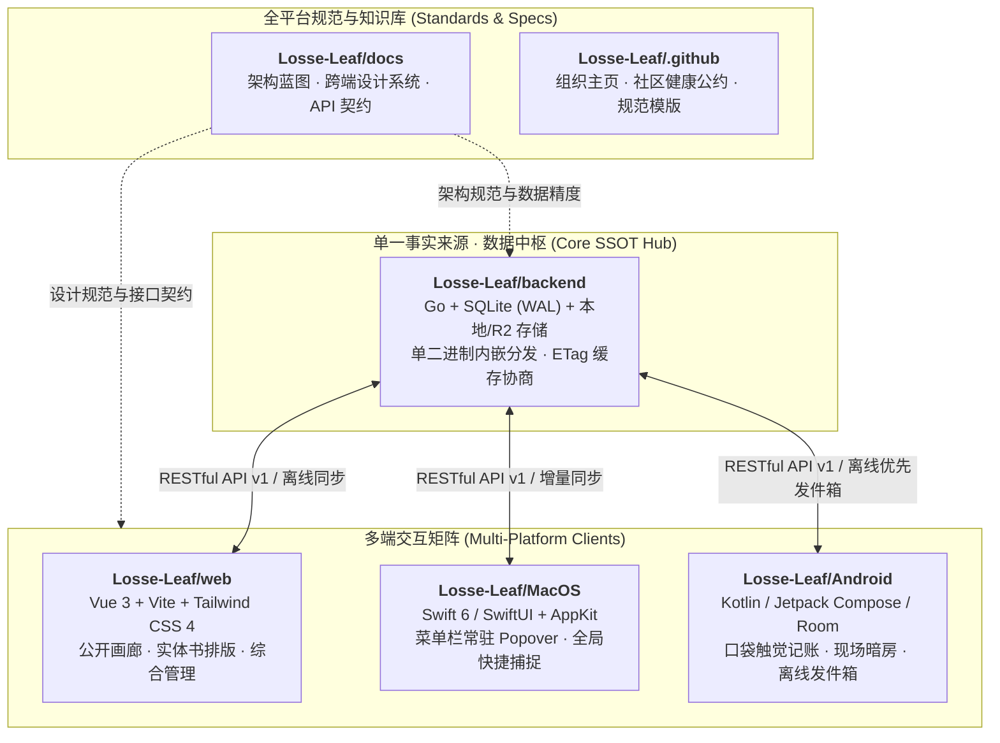

<div align="center">

# 《散页》 · Loose Leaf

**Living Archive & Personal Darkroom · 拾起散落的时光，装订成册**

*一座反功利、重真实、高质感的个人生活数字档案馆与全平台数据中枢*

[](https://github.com/Losse-Leaf/backend/releases)
[](https://github.com/Losse-Leaf/web/releases)
[](https://github.com/Losse-Leaf/MacOS/releases)
[](https://github.com/Losse-Leaf/Android/releases)
[](https://github.com/Losse-Leaf)

</div>

---

> *「不想再把自己的网络主页做成一份展示给招聘者或甲方的技术简历了。*  
> *这里是一方安静的生活自留地——将散落的日常随笔、35mm 胶卷底片、山川行迹、心愿清单与柴米油盐，一页页装订成册。」*

---

## 一、设计初衷与架构哲学

在算法信息流与模板化个人主页泛滥的今天，《散页》（Loose Leaf）试图回归**实体出版物与银盐暗房**的克制质感。它既是一个可以向访客静心展示的生活画廊，也是主理人私密掌控的个人全平台数据中枢：

- **纸墨与暗房双生美学 (Paper & Darkroom)**  
  摒弃刺眼的毛玻璃与浮夸特效，采用原生 SVG 温润棉纸微噪点、35mm 胶片装裱框（`.film-frame`）、复古四角裁切线与大地色系光谱；内置零外部音频依赖的 Web Audio 机械快门与纸张翻动声学合成器，支持「暖调棉纸」与「暗房安全灯」双模式静默切换。
- **单二进制极简分发 (Single Binary, Zero Docker)**  
  基于 `CGO_ENABLED=0` 纯 Go 架构与纯 Go 版 SQLite（WAL 并发模式），通过 `//go:embed` 将完整 Web 前端展厅熔铸进**单个可执行文件**。无需配置 Docker、Node.js 或 Nginx，无论是海外 VPS、家用 NAS 还是闲置安卓设备（Termux + Tailscale 异地组网），下载单文件赋权即跑。
- **一次性认领码与设备子钥匙体系 (Zero `.env` Secret, Zero Password)**  
  彻底告别繁琐的 `.env` 密钥配置，也不设任何传统密码。冷启动首次运行时程序在标准输出打印**一次性认领码**（15 分钟有效），在网页输入即认领首台设备；其余设备由已登录端签发 5 分钟配对二维码扫码接入，各自持有独立的**设备子钥匙（`lldt_...`）**，支持多端设备独立鉴权与随时静默解绑。
- **主客同源与财务隐私硬隔离 (Privacy by Design)**  
  一体两面：主理人登录后掌控全站创作与记账大盘；访客从扉页点击「静心翻阅」直入只读展厅。一切私密账单、流动资金底数、信贷分期以及心愿、足迹、年鉴中的敏感金额，在后端接口层与 ETag 缓存层均执行严格的**角色隔离与自动脱敏**。
- **离线优先发件箱机制 (Offline-First Outbox Pattern)**  
  移动端与桌面伴随端内置离线优先发件箱引擎。断网或弱网环境下记录闪念、现场拍照或录入账目，数据先安全保存在本地轻量数据库中，网络就绪后由后台调度器静默续传，确保任何灵感都不因网络抖动而中断。
- **记录为一切的母体 (Record-First Architecture)**  
  生命没有孤立的足迹库或造物库。所有足迹、造物、心愿与账目均溯源于时间轴上一级发生的真实生活记录（`LifeEntry`）。二级视界联动自动生成主时间流条目，拒绝数据孤岛，杜绝极客虚假黑话与空洞装饰。

---

## 二、六大典藏卷宗

| 卷宗模块 | 核心体验与特性 |
| :--- | :--- |
| **时间流与编年归档**<br/>*Life Stream & Archive* | 支持日常随笔、胶卷相片、手艺造物与好物收藏的多态刊物排版；内置 365 天生活刻度热力图，相邻记录跨度 $\ge 14$ 天自动生成「岁月留白」呼吸切线。 |
| **山川行迹与两级抽屉**<br/>*Travel Atlas & Drawers* | 采用中国国家标准 Albers 等面积圆锥投影，绘制**省＋市两级墨色阶点亮地图**；点击任意已点亮省市，平滑滑出聚合「履迹简志、菲林画廊、散页随笔、属地账单光谱」的四重回忆抽屉。 |
| **三维心愿单与归册仪式**<br/>*Three-State Wishlist* | 涵盖「心仪好物 / 山川旅程 / 人生里程碑」；支持**在愿蓄水池**、**理性拔草**（正向统计因克制欲望而省下的财富）与**圆满归册**（一键事务联动生成支出账单、时间流随笔并点亮城市足迹）。 |
| **年度生活年鉴五幕画卷**<br/>*Annual Almanac* | 自动提炼「岁月卷首、山川行迹、向往风物、人间烟火、高光画廊」五幕岁末长卷；深度定制 `@media print` 打印样式，一键隐去交互控件、铺展为标准 A4 纸张，随时导出高清 PDF 或装订成实体书。 |
| **柴米油盐与资产中枢**<br/>*Ledger & Assets Hub* | 全链路 `cents`（整型分）无损记账；构建「在用固定资产 + 流动资金池 - 待还分期负债」三层净资产模型；支持设备二手回血核销与多信贷渠道独立还款日追踪。 |
| **暗房媒体与双模存储**<br/>*R2 & Local Media* | 数据库仅持久化纯净相对路径（Object Key）；未配置云存储时默认开箱直存本地磁盘（`/media`），配置 Cloudflare R2 后无缝切换为端侧动态预签名临时 URL（30 分钟有效 + 幂等缓存）。 |

---

## 三、生态仓库矩阵 (Repositories)



| 仓库 | 定位与职责 | 技术栈 | 最新版本 |
| :--- | :--- | :--- | :---: |
| **[`Losse-Leaf/backend`](https://github.com/Losse-Leaf/backend)** | **后端数据中枢与单二进制分发引擎**<br/>提供 RESTful API v1、母子设备令牌鉴权、SQLite WAL 持久化、R2 预签名引擎及内嵌 Web 静态服务 | `Go` · `Gin` · `GORM` · `SQLite` · `Cloudflare R2` | [](https://github.com/Losse-Leaf/backend/releases) |
| **[`Losse-Leaf/web`](https://github.com/Losse-Leaf/web)** | **Web 官方展厅与后台管理终端**<br/>纸墨与暗房双主题、全自研纸本表单控件、六大业务视图与 Web Audio 拟物声学引擎 | `Vue 3` · `TypeScript` · `Vite` · `Tailwind CSS 4` | [](https://github.com/Losse-Leaf/web/releases) |
| **[`Losse-Leaf/MacOS`](https://github.com/Losse-Leaf/MacOS)** | **macOS 桌面伴随工作台**<br/>Menubar 常驻快速捕捉、全局快捷键呼出 (`Cmd+Shift+L`)、紧凑朋友圈式时间戳、受保护凭据档案 (`0600`) | `Swift 6` · `SwiftUI` · `AppKit` | [](https://github.com/Losse-Leaf/MacOS/releases) |
| **[`Losse-Leaf/Android`](https://github.com/Losse-Leaf/Android)** | **Android 随行口袋暗房与记账本**<br/>触觉大键位记账键盘、端侧 EXIF 智能压制、离线优先发件箱 (Outbox Engine)、生物识别安全锁 | `Kotlin` · `Jetpack Compose` · `Room` · `WorkManager` | [](https://github.com/Losse-Leaf/Android/releases) |
| **[`Losse-Leaf/docs`](https://github.com/Losse-Leaf/docs)** | **全平台架构设计与工程规范专著**<br/>生态演进蓝图、后端与多端协同规范、Web 展厅设计系统、桌面与移动端开发指南、整改总台账 | `Markdown` · `Mermaid` · `Architecture Specs` | 主干基准 |
| **[`Losse-Leaf/.github`](https://github.com/Losse-Leaf/.github)** | **组织级配置与社区健康中心**<br/>全组织默认社区公约、贡献指南、安全政策、PR 与 Issue 模版 | `Community Health` · `Issue Forms` | 主干基准 |

---

## 四、极速启动 (Quick Start)

无需安装 Go、Node.js、Docker 或配置任何复杂的数据库环境，直接从 [**Backend Releases**](https://github.com/Losse-Leaf/backend/releases) 下载对应系统的单二进制文件即可运行：

### 1. 运行中枢服务

```bash
# 以 Linux x86_64 为例（macOS Apple Silicon 请下载 looseleaf-darwin-arm64）
curl -fLO https://github.com/Losse-Leaf/backend/releases/latest/download/looseleaf-linux-amd64
chmod +x looseleaf-linux-amd64

# 直接启动（默认监听 :8088，自动在 ./data 下生成 SQLite 库与本地媒体目录）
./looseleaf-linux-amd64
```

终端标准输出将显示类似如下的一次性认领码：
```
======================================================
  《散页》首次运行就绪！请在浏览器打开中枢完成初始配对：
  http://localhost:8088
  一次性入网认领码: 8A2F-9C4D (15 分钟内有效)
======================================================
```

### 2. 浏览与入网

1. **Web 展厅**：在浏览器打开 `http://localhost:8088`，点击扉页的「认领中枢」，输入控制台打印的认领码，完成主理人首台设备绑定并设定管理密令。
2. **多端接入**：在 Web 展厅管理后台「展台 / 设备」中点击「添加受信任设备」，生成 5 分钟有效的动态配对二维码；打开 [**macOS 客户端**](https://github.com/Losse-Leaf/MacOS/releases) 或 [**Android 随行端**](https://github.com/Losse-Leaf/Android/releases) 扫描二维码（或粘贴配对链接），即可完成受信任设备组入网。

---

## 五、跨端工程规范核心准则

无论面向哪个平台开发，参与者均严格遵守以下核心法则：

1. **单一事实来源 (SSOT)**：后端 SQLite 数据库是所有状态的唯一权威；各客户端本地数据库仅作为只读缓存与待同步发件箱。
2. **金额严格以整数分流转 (Cents Precision)**：全链路严禁浮点数，金额单位统一为分（`int64`）。
3. **弹性时间与北京时间基准 (FlexTime UTC+8)**：时间格式弹性解析，显示基准统一锁定为中国北京时间（UTC+8），消除跨时区漂移。
4. **实体书与暗房相纸质感**：严格遵循自然大地色盘（棉纸底色、深暖墨黑、暖赭石、苔藓绿等），杜绝塑料渐变与刺眼特效。
5. **记录为一切的母体 (Record-First)**：所有足迹、造物、心愿、记账行为均溯源并伴生于一级生活档案（`LifeEntry`）。
6. **不留妥协债务与过渡层**：拒绝冗余死代码、假数据兜底或过渡兼容分支。

更多详尽规范请查阅 [**全平台架构设计与工程规范专著 (docs)**](https://github.com/Losse-Leaf/docs)。

---

## 六、参与装帧 (Contributing)

《散页》欢迎认同其设计理念的创作者与工程师共同雕琢：

- 查阅 [**全组织贡献指南 (CONTRIBUTING.md)**](https://github.com/Losse-Leaf/.github/blob/main/CONTRIBUTING.md) 了解开发流程与提交要求。
- 查阅 [**社区公约 (CODE_OF_CONDUCT.md)**](https://github.com/Losse-Leaf/.github/blob/main/CODE_OF_CONDUCT.md) 维护宁静、专注、真诚的交流氛围。
- 发现漏洞或安全隐患请参照 [**安全政策 (SECURITY.md)**](https://github.com/Losse-Leaf/.github/blob/main/SECURITY.md) 执行负责任披露。

---

<div align="center">

*Paper & Film · Living Archive · Built with quiet craftsmanship.*

</div>
