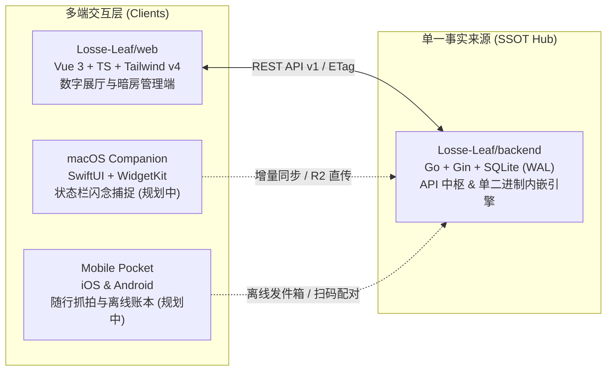

<div align="center">

# 《散页》 · Loose Leaf

**Living Archive & Personal Darkroom · 拾起散落的时光，装订成册**

*一座反功利、重真实、高质感的个人生活数字档案馆与全平台数据中枢*

[](https://github.com/Losse-Leaf/backend/releases)
[-181716?style=flat-square)](https://github.com/Losse-Leaf/backend)
[](https://github.com/Losse-Leaf/web)
[-8c5a3c?style=flat-square)](https://github.com/Losse-Leaf/backend/releases)

</div>

---

> *「不想再把自己的网络主页做成一份展示给招聘者或甲方的技术简历了。*  
> *这里是一方安静的生活自留地——将散落的日常随笔、35mm 胶卷底片、山川行迹、心愿清单与柴米油盐，一页页装订成册。」*

---

## 一、设计初衷与架构哲学

在算法信息流与模板化个人主页泛滥的今天，《散页》（Loose Leaf）试图回归**实体出版物与银盐暗房**的克制质感。它既是一个可以向访客静心展示的生活画廊，也是主理人私密掌控的个人数据中枢：

- **纸墨与暗房双生美学（Paper & Darkroom）**  
  摒弃刺眼的毛玻璃与浮夸特效，采用原生 SVG 温润棉纸微噪点、35mm 胶片装裱框（`.film-frame`）、复古四角裁切线与大地色系光谱；内置零外部音频依赖的 Web Audio 机械快门与纸张翻动声学合成器，支持「暖调棉纸」与「暗房安全灯」双模式静默切换。
- **单二进制极简分发（Single Binary, Zero Dependency）**  
  基于 `CGO_ENABLED=0` 纯 Go 架构与纯 Go 版 SQLite（WAL 并发模式），通过 `//go:embed` 将完整 Web 前端展厅熔铸进**单个可执行文件**。无需配置 Docker、Node.js 或 Nginx，无论是海外 VPS、树莓派、家用 NAS，还是闲置安卓手机（Termux + Tailscale 异地组网），下载单文件赋权即跑。
- **首次装帧向导与「母子钥匙」体系（Zero `.env` Secret）**  
  彻底告别繁琐的 `.env` 密钥配置。冷启动首次访问时独占开启**两步装帧向导**：双次设定主理人母密钥（仅存 SHA-256 哈希）并生成散页纸墨风配对二维码；日常访问采用母密钥或扫码配对签发独立的**设备子钥匙（`lldt_...`）**，支持多端设备独立鉴权与随时静默解绑。
- **主客同源与财务隐私硬隔离（Privacy by Design）**  
  一体两面：主理人登录后掌控全站创作与记账大盘；访客从扉页点击「静心翻阅」直入只读展厅。一切私密账单、流动资金底数、信贷分期以及心愿、足迹、年鉴中的敏感金额，在后端接口层与 ETag 缓存层均执行严格的**角色隔离与自动脱敏**。

---

## 二、六大典藏卷宗

| 卷宗模块 | 核心体验与特性 |
| :--- | :--- |
| **时间流与编年归档**<br/>*Life Stream & Archive* | 支持日常、随笔想法、胶卷相片、手艺造物与好物收藏的多态刊物排版；内置对标 GitHub 的 **365 天生活刻度热力图**，相邻记录跨度 $\ge 14$ 天自动生成「岁月留白」呼吸切线。 |
| **山川行迹与两级抽屉**<br/>*Travel Atlas & Drawers* | 采用中国国家标准 Albers 等面积圆锥投影，绘制**省＋市两级墨色阶点亮地图**；点击任意已点亮省份或城市，平滑滑出聚合「履迹简志、菲林画廊、散页随笔、属地账单光谱」的四重回忆抽屉。 |
| **三维心愿单与归册仪式**<br/>*Three-State Wishlist* | 涵盖「心仪好物 / 山川旅程 / 人生里程碑」；支持**在愿蓄水池**、**理性拔草**（正向统计因克制欲望而省下的财富）与**圆满归册**（一键事务联动生成支出账单、时间流随笔并点亮城市足迹）。 |
| **年度生活年鉴五幕画卷**<br/>*Annual Almanac* | 自动提炼「岁月卷首、山川行迹、向往风物、人间烟火、高光画廊」五幕岁末长卷；深度定制 `@media print` 打印样式，一键隐去交互控件、铺展为标准 A4 纸张，随时导出高清 PDF 或装订成实体书。 |
| **柴米油盐与资产中枢**<br/>*Ledger & Assets Hub* | 全链路 `cents`（整型分）无损记账；构建「在用固定资产 + 流动资金池 - 待还分期负债」三层净资产模型；支持设备二手回血核销与多信贷渠道独立还款日追踪。 |
| **暗房媒体与双模存储**<br/>*R2 & Local Media* | 数据库仅持久化纯净相对路径（Object Key）；未配置云存储时默认开箱直存本地磁盘（`/media`），配置 Cloudflare R2 后无缝切换为动态预签名临时 URL（30 分钟有效 + 幂等缓存）。 |

---

## 三、生态仓库矩阵 (Repositories)



| 仓库 | 定位与职责 | 技术栈 | 状态 |
| :--- | :--- | :--- | :---: |
| **[`Losse-Leaf/backend`](https://github.com/Losse-Leaf/backend)** | **后端数据中枢与单二进制分发引擎**<br/>提供 RESTful API v1、母子设备令牌鉴权、SQLite WAL 持久化、R2 预签名引擎及内嵌 Web 静态服务 | `Go` · `Gin` · `GORM` · `SQLite` · `Cloudflare R2` | [`v1.1.0`](https://github.com/Losse-Leaf/backend/releases) |
| **[`Losse-Leaf/web`](https://github.com/Losse-Leaf/web)** | **Web 官方展厅与后台管理终端**<br/>纸墨与暗房双主题、全自研纸本表单控件、六大业务视图与 Web Audio 拟物声学引擎 | `Vue 3` · `TypeScript` · `Vite` · `Tailwind CSS 4` | [`v1.1.0`](https://github.com/Losse-Leaf/web/releases) |
---

## 四、极速启动 (Quick Start)

无需安装 Go、Node.js、Docker 或配置任何 `.env` 文件，直接从 [**Backend Releases**](https://github.com/Losse-Leaf/backend/releases) 下载对应系统的单二进制文件即可运行：

```bash
# 以 Linux x86_64 为例（macOS Apple Silicon 请下载 looseleaf-darwin-arm64）
curl -fLO https://github.com/Losse-Leaf/backend/releases/latest/download/looseleaf-linux-amd64
chmod +x looseleaf-linux-amd64

# 直接启动（默认监听 :8088，自动在 ./data 下生成 SQLite 库与本地媒体目录）
./looseleaf-linux-amd64
```

随后在浏览器打开 `http://localhost:8088`（或你的服务器 IP / Tailscale 虚拟局域网地址），即可进入《散页》**首次装帧扉页**，设定主理人密钥并开启你的私人生活档案馆。

---

<div align="center">

*Paper & Film · Living Archive · Built with quiet craftsmanship.*

</div>
